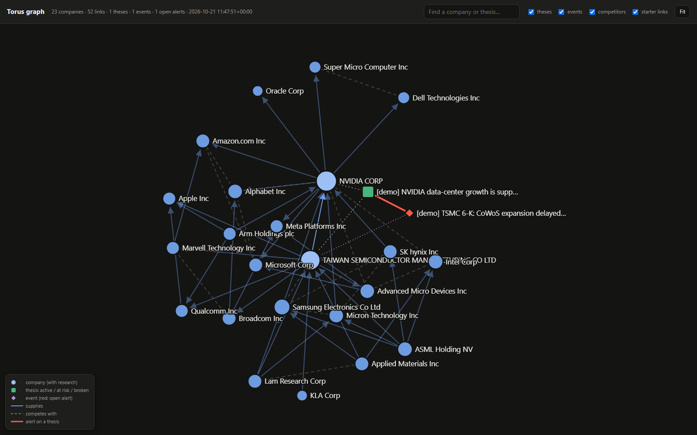
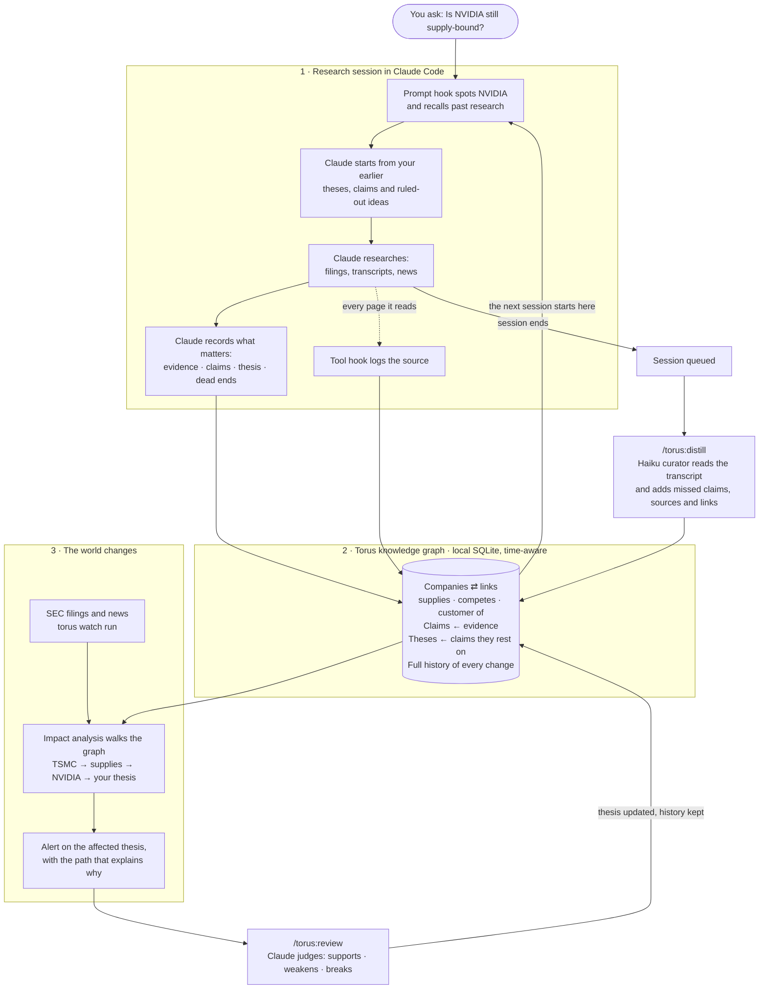
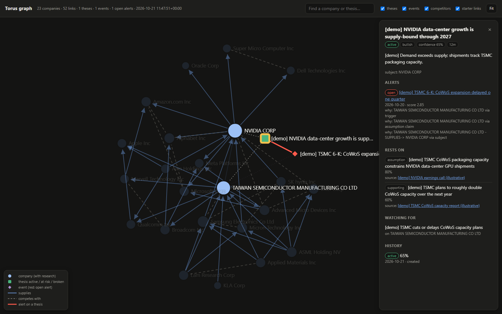

# Torus

A persistent research knowledge graph for AI agents.

When you research companies with Claude Code, Torus keeps what the research found:

- the **companies** and the links between them (suppliers, customers, competitors)
- **claims**, each tied to the **evidence** that supports it
- **theses**, with the claims they rest on and what would break them
- **ideas you ruled out**

Each new session starts from what earlier sessions learned. When a filing or news item arrives,
Torus works out which of your theses it touches and why.

- **Your model, your subscription.** Torus never calls an LLM itself. The agent in your harness
  (Claude Code today) does the reasoning, and a cheaper Haiku "curator" tidies up afterwards.
- **Local-first.** Everything lives in one SQLite file under `~/.torus` (override with
  `TORUS_HOME`).
- **Time-aware.** Every fact records both when it was true and when it was believed, so you can
  ask what the graph said on any past date.

See [CHANGELOG.md](CHANGELOG.md) for what's in each release.



## How it works



**Why this helps.** Research done in chat is usually thrown away: the next session starts from
scratch, and nothing connects new information to what you already concluded. Torus keeps the
working parts of the research, not just the final report:

| Without Torus | With Torus |
|---|---|
| Every session re-reads the same filings and rediscovers the same facts | Each session starts from earlier theses, claims and ruled-out ideas |
| A report says "TSMC capacity is the constraint", but not where that came from | Every claim links to its source, with a confidence and the date it was true |
| A TSMC filing arrives and nobody notices that it undermines your NVIDIA view | Impact analysis follows supplier and customer links and raises an alert on that thesis |
| Old conclusions get overwritten | Every change is versioned, so you can ask what you believed on any date |
| Dead ends get explored again | Ruled-out ideas are recalled alongside the theses |

## Getting started (about 5 minutes)

```bash
pip install -e .                       # puts the `torus` command on your PATH
torus init --refresh-reference --contact you@example.com   # SEC ticker list (the SEC asks for an email)
torus graph seed semis                 # optional: a starter semiconductor value chain
torus doctor                           # check that everything is in order
```

Then, in Claude Code:

```
/plugin marketplace add /path/to/torus
/plugin install torus@torus
```

You'll be asked for a **capture mode**:

| Mode | What Claude records while researching | The curator (Haiku) records later |
|---|---|---|
| `balanced` (default) | theses, key claims with sources, ideas ruled out | supporting claims, extra sources, links |
| `live` | everything | anything missed |
| `curator` | theses and ideas ruled out | everything else |

Now research as usual, e.g. *"Is NVIDIA still supply-bound? Check TSMC's CoWoS plans."* The next
time you mention NVIDIA, Claude sees the earlier thesis, claims and ruled-out ideas before it
starts.

## Commands in Claude Code

| Command | What it does |
|---|---|
| `/torus:status` | Theses at risk, open alerts, recent changes |
| `/torus:review` | Judge open alerts: did the event support, weaken or break the thesis? |
| `/torus:distill` | Have the Haiku curator add past sessions' findings to the graph |
| `/torus:explore` | Open the visual graph explorer |

## The visual explorer

```bash
torus explore                 # the whole graph
torus explore NVDA --hops 2   # NVIDIA and everything within two links
torus explore --no-open       # write the file without opening a browser
```

This writes a single self-contained HTML file (default `~/.torus/explorer.html`) and opens it in
your browser. It works offline and needs nothing installed, so you can share the file.



*The screenshots use the `semis` starter pack plus illustrative `[demo]` research
(`scripts/seed_demo.py`). In the one above, the `[demo]` NVIDIA thesis is selected. A TSMC filing
has raised an alert on it, and the panel shows why: the thesis has a trigger on TSMC, an
assumption claim that names TSMC, and TSMC supplies NVIDIA, the thesis's subject.*

- **Nodes:** companies are blue circles; darker means you have research on them. Theses are
  squares coloured by status (green active, amber at risk, red broken). Events are diamonds, red
  when they have an open alert.
- **Lines:** solid arrows mean *supplies*, dashed lines mean *competes with*, and a thick red line
  is an alert from an event to a thesis. Faint lines come from a starter pack and haven't been
  confirmed by your research yet.
- **Click** any node for details. A company shows its links, theses, recent claims with sources,
  and ideas ruled out. A thesis shows what it rests on, its triggers, its history and its alerts,
  with the path that explains each one.
- **Move around:** drag nodes, scroll to zoom, drag the background to pan, and press **Fit** to
  reset. Double-click a node to release it.
- **Search** by name or ticker. **Filters** hide theses, events, competitor links or starter
  links.
- **Link to a node:** add `#select=` and a name or ticker to the file's address, e.g.
  `explorer.html#select=NVDA`, and the explorer opens with that node selected.

The file is a snapshot. Run `torus explore` again after new research.

## Graph tools

```bash
torus graph packs                      # available starter packs
torus graph seed semis                 # ~23 companies, ~52 curated links, marked starter:semis@1
torus graph neighbors TSM --hops 2     # links around a company
torus graph paths ASML AMD             # how two companies connect: ASML -SUPPLIES-> TSMC -SUPPLIES-> AMD
```

Claude has the same tools through MCP (`neighbors`, `find_paths`, `impact`). Starter links never
overwrite links your research recorded, and when research re-records a starter link, it becomes
yours.

## Watchers: filings and news become alerts

`torus watch run` checks once:

- **SEC EDGAR**: new filings (8-K, 10-Q, 10-K, 20-F, 6-K, ...) by watched companies.
- **RSS/Atom feeds**: items that mention companies already in your graph.

Each new item becomes an event. Torus then walks the graph (suppliers, customers, competitors)
and opens alerts on theses it may affect. Review them with `/torus:review`.

```bash
torus config set sec_contact you@example.com   # required by the SEC, sent as the User-Agent
torus watch add NVDA                            # optional: open theses' companies are watched automatically
torus feed add https://example.com/semis.rss --name "Semis wire"
torus watch list                                # what is watched, and why
torus watch run                                 # one pass; exit code 1 if any source failed
```

The first check of a company or feed looks back 7 days. After that, only new items are processed.
Run it on a schedule:

```bash
# macOS / Linux (crontab -e): every hour
0 * * * * torus watch run >> ~/.torus/logs/watch.log 2>&1
```

```powershell
# Windows: every hour
schtasks /Create /SC HOURLY /TN "Torus watch" /TR "torus watch run"
```

## Maintenance

```bash
torus doctor                  # health check (schema, integrity, search index, hooks, watchers)
torus doctor --repair         # rebuild the search index
torus export                  # back up everything to TORUS_HOME/exports/*.jsonl
torus import backup.jsonl     # restore into a fresh TORUS_HOME
torus status                  # row counts and queue state
```

Hook activity is logged to `~/.torus/logs/hooks.log`. Hooks never block or fail your session.

## Development

```bash
python -m venv .venv
.venv/Scripts/python -m pip install -e ".[dev]"   # .venv/bin/python on macOS/Linux
.venv/Scripts/python -m pytest                    # unit + integration (no network)
.venv/Scripts/python -m pytest -m perf tests/perf # performance checks on a 100k-claim graph
```

## License

Apache License 2.0. See [LICENSE](LICENSE).

Torus is a research memory, not financial advice.
